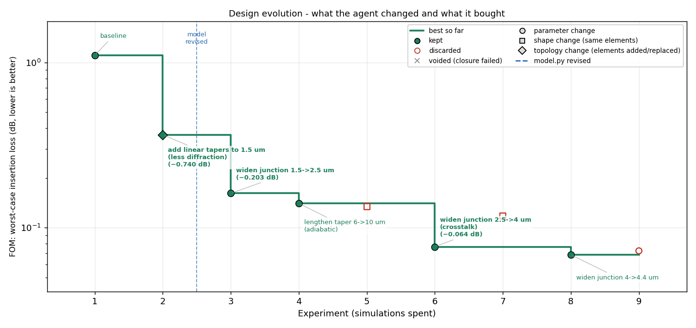

# photonics-design-agent

An LLM agent that designs passive photonic devices by running simulations in a loop,
and that has to **explain its reasoning before each simulation**.

Method name: PRISM-Min. Status: v0.1, loop verified on a toy backend; Lumerical backend
written but not yet validated. Chinese: [README_zh.md](README_zh.md).



## The problem

You can already let an LLM edit a geometry file, run FDTD, and keep the result if the number
got better. That works, but you learn nothing from it: 50 simulations later you have a good
design and a pile of "tried X, got Y" notes. You cannot tell which change mattered, whether
the agent understood the physics or got lucky, or whether the simulation itself was trustworthy.

This project keeps that loop and adds three things:

1. **Loss breakdown instead of one number.** Each simulation returns where the power went
   (through-port fundamental mode, higher-order modes, crosstalk, reflection, radiation) and a
   measured flux-closure check. The agent sees *which* channel to attack.
2. **Prediction before measurement.** The agent maintains `model.py`, a small physics model it
   wrote itself. It must predict the result (with an uncertainty) before every simulation. If
   the measurement misses by more than 2σ, the next turn is spent fixing `model.py`, not the
   design.
3. **A record of what was done and why.** Every turn declares its change type (parameter /
   shape / topology) and a one-line label. The evolution chart above is built from that.

The runner enforces these rules in code. The agent cannot change simulation settings, cannot
skip the prediction, and cannot score a run whose closure failed.

## How it works

```
program.md  (you: goal, constraints, budget)        sim_config.py  (you: locked FDTD settings)
      │                                                     │
      ▼                                                     ▼
 agent writes design.py ──► DRC + sanity checks ──► model.py predicts ──► simulate
                                 │ fail: revert,            (registered)      │
                                 │ no simulation spent                        ▼
                                                               breakdown + closure check
 journal / laws.md / evolution.png ◄── keep or revert ◄──── FOM + constraints
                                        │
                                        └── miss > 2σ ? next turn edits model.py only
```

One iteration, in words: the agent reads the task, the current design, its model, its notes
and the last breakdown; states a hypothesis; rewrites `design.py`; the runner builds the
geometry, checks it, asks `model.py` for a prediction, simulates, decomposes the loss, and keeps
the design only if it beats the best by more than the noise threshold with constraints met.

## Install

```bash
git clone https://github.com/q3430468220-tech/photonics-design-agent.git
cd photonics-design-agent
pip install -e .
cp .env.example .env     # add ANTHROPIC_API_KEY or OPENAI_API_KEY (+ OPENAI_BASE_URL for DeepSeek/Qwen)
```

Needs Python ≥ 3.9, numpy, matplotlib, requests. No vendor SDKs.
For real simulations: Lumerical FDTD with `LUMERICAL_ROOT` pointing at the install folder.

## Use

**Try it without any key or simulator** (scripted agent, analytic toy backend, ~10 s):

```bash
python examples/demo_scripted.py
```

**Run a real experiment:**

```bash
prism init experiments/my_device         # copies the crossing template
#   edit experiments/my_device/program.md  — goal, constraints, FOM, budget
#   edit experiments/my_device/design.py   — a valid starting geometry
#   edit experiments/my_device/sim_config.py if the band / mesh / rules differ

prism check experiments/my_device --plot            # builds the geometry, runs DRC + sanity, no simulation
prism eval  experiments/my_device --manual --backend lumerical
#   one simulation you trigger yourself. Read the breakdown table and the closure error.
#   If the judge is wrong here, everything after it is wrong. Fix sim_config.py first.

prism run   experiments/my_device --backend lumerical --sims 50
prism status experiments/my_device
prism plot   experiments/my_device                  # evolution.png (also refreshed every iteration)
prism review experiments/my_device                  # a fresh LLM session audits laws.md against the journal
```

Use `--backend mock` anywhere to run the same commands on the toy model.

## Files in an experiment

| file | who edits | what it is |
|---|---|---|
| `program.md` | you | the task, in plain language |
| `sim_config.py` | you | locked settings: band, mesh, PML, DRC rules, FOM thresholds, budget |
| `design.py` | agent | `build() -> Geometry` |
| `model.py` | agent | `predict(geom) -> {fom, sigma, ...}`, its physics model |
| `laws.md` | agent | lessons, append-only, tagged tentative / confirmed |
| `journal.jsonl` / `.md` | runner | every turn: hypothesis, change, type, prediction, measurement, breakdown, decision |
| `evolution.png` | runner | the chart above |
| `runs/iter_NNN/` | runner | snapshots, raw LLM reply, simulation data, plots |
| `best/design.py` | runner | best kept design |

## What a simulation returns

```
wl(um)  IL(dB)  TE0     higher  xtalk   refl    rad     box
1.5300   1.069  0.7818  0.0001  0.0925  0.0002  0.1239  0.9986
```

Fractions of injected power. `TE0` is the useful transmission; the FOM is the worst-case
insertion loss over the band. `box` is the measured total outward flux through a box enclosing
the device; it must be 1 ± `closure_tol` or the run is voided (bad measurement ≠ bad design).

## Backends

- `mock`: analytic toy model of a waveguide crossing. For testing the loop, not for physics.
- `lumerical`: FDTD through lumapi. Builds sources, monitors, a 6-face flux box and a field
  plot from `sim_config.py`. **Not yet run on a real installation** — validate with
  `prism eval --manual --backend lumerical`. Material names and mode-expansion result keys are
  the likely first fixes.

## Current template

`experiments/soi_crossing`: a 220 nm SOI waveguide crossing, target worst-case insertion loss
< 0.06 dB over 1530–1570 nm, crosstalk < −30 dB, 4-fold symmetric, 40 µm footprint.

## Not done yet

- Lumerical backend validation on real hardware.
- Baseline comparison (same loop without breakdown / prediction / gate; random search; CMA-ES)
  to measure whether the additions actually help. The journal is machine-readable for this.
- More geometry helpers (arcs, Bézier, periodic arrays) so the agent fails less at writing polygons.
- Active devices (MRM, TFLN modulators): same idea, different decomposition algebra.

## Layout

```
prism_min/
  geometry.py    polygons + ports, raster helpers
  checks.py      DRC and sanity checks
  config.py      SimConfig
  features.py    geometry measurements shared by mock, prompts and model.py
  backends/      base, mock, lumerical
  decompose.py   loss breakdown, closure, FOM
  guard.py       no simulation without a registered prediction
  evaluate.py    build -> checks -> guard -> simulate -> closure -> score
  experiment.py  experiment folder handling
  journal.py     journal + digest for the agent
  llm.py         Anthropic / OpenAI-compatible / scripted
  prompts.py     prompts
  agent.py       the loop
  viz.py         geometry preview, evolution chart
  cli.py         prism ...
experiments/soi_crossing/   template
examples/demo_scripted.py   offline demo
tests/                      python -m unittest discover -s tests -t .
```

MIT license.
