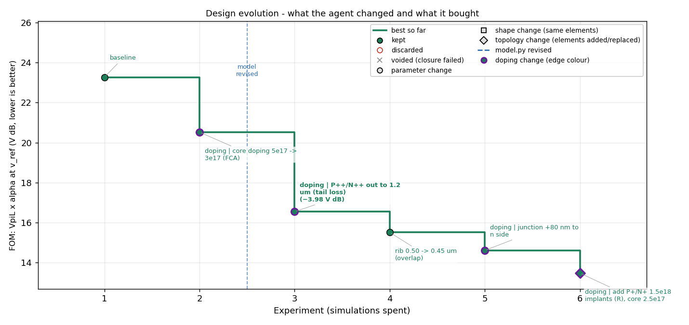
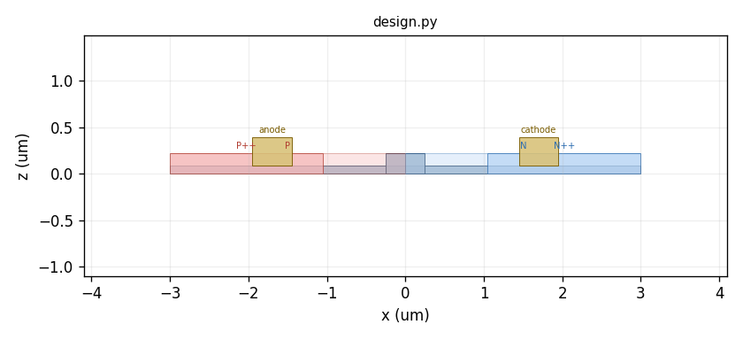
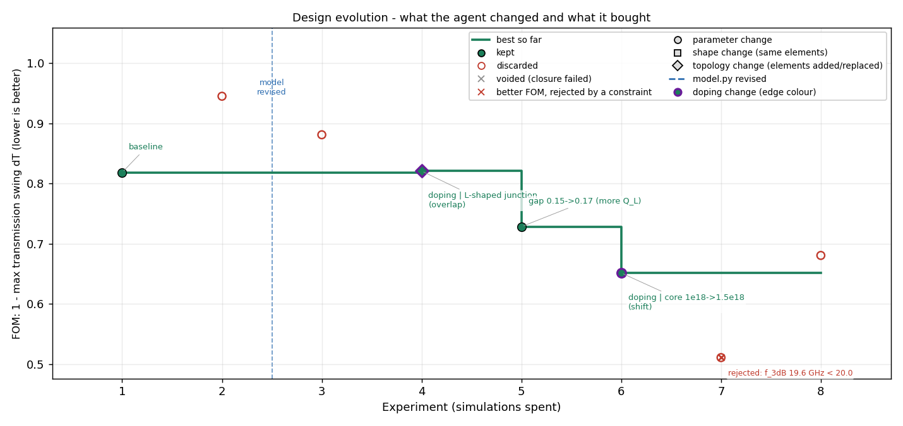
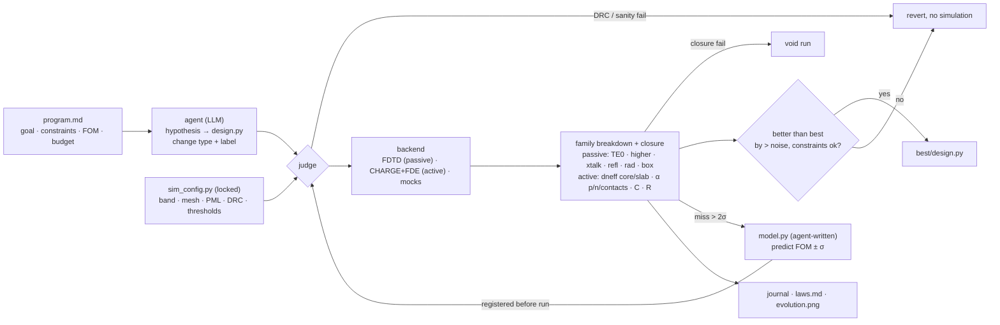

# photonics-design-agent

**An LLM agent that designs passive and active photonic devices by running Lumerical simulations in a loop — FDTD for waveguide components, CHARGE + FDE for PN phase shifters — and that must predict every result before it measures it, explain where the loss (or the efficiency, or the bandwidth) went after, and record which kind of change (parameter, shape, topology; geometry, doping, electrode) bought each improvement.**

[English](README.md) | [简体中文](README_zh-CN.md)


Letting a language model edit a geometry file, run FDTD and keep the result when the number improves is easy to set up and it does find good devices. What it does not give you is understanding: after fifty simulations you have a design and a log of "tried X, got Y", but you cannot say which change mattered, whether the model grasped the physics or stumbled onto the answer, or whether a given simulation was even trustworthy. For a research tool that is the wrong trade. This repository keeps that simple loop (the method is called **PRISM-Min**) and adds three things that are enforced by code, not by prompt: every simulation returns a **loss breakdown with a measured flux closure**, the agent must **register a prediction from its own physics model** before each run and fix the model when it is wrong, and every turn is **tagged with the kind of change it made**, so the optimisation history reads as a sequence of design decisions rather than a random walk.

<p align="center">
  <br>
  <em>Passive family, offline demo: a 220 nm SOI waveguide crossing goes from 1.09 dB to 0.069 dB in eight simulations. Marker shape = kind of change, label = the agent's own reason, bold = jumps above 15 %, dashed line = the agent rewrote its physics model.</em>
</p>
<p align="center">
  <br>
  <br>
  <em>Active family, offline demo: a lateral PN phase shifter (VπL × α at −2 V) improved from 23 to 13.5 V dB by doping, junction, rib-width and implant changes; purple edges mark doping-domain changes. Below: the cross-section the agent edits (red p, blue n, darker = heavier; contacts in gold).</em>
</p>
<p align="center">
  <br>
  <em>Ring level, offline demo: a PN microring modulator judged on its transmission swing between 0 V and −2 V under a 20 GHz bandwidth constraint. The agent trades coupling (Q_L) against photon lifetime, then buys shift per volt with an L-shaped junction and heavier doping; experiment 7 had the best swing but is rejected because f_3dB fell to 19.6 GHz, and the chart says so.</em>
</p>

## What is inside

The code has four parts plus a device-family layer. Each one can be replaced on its own.

**Device families** (`prism_min/families/`) hold everything that depends on *what* is being designed: how a geometry is measured, which rules it must obey, how a simulation result is decomposed, what the FOM and the constraints are, and how a result is summarised for the agent. Three families ship. `passive_4port` is a layout (plane *xy*) with four ports — crossings, and with small changes bends, tapers, MMIs — judged by FDTD. `pn_phase_shifter` is an *xz* cross-section of a PN junction — rib, slab, implant windows with concentrations (lateral, offset, L-shaped or vertical junctions are all just several windows), metal contacts — judged by CHARGE + FDE; its FOM is VπL × α at a reference bias with an RC-bandwidth constraint. `pn_ring_modulator` is that cross-section plus three ring parameters in `Geometry.meta` (radius, coupler gap, doped fraction); the judge adds the Q budget (coupling, bend, free-carrier, background), the resonance shift per volt, the two-state transmission spectra and the swing, ER and IL at the best wavelength, and the bandwidth from the photon lifetime and RC in quadrature. Adding a family (TFLN MZM, thermo-optic shifter, photodetector) means writing one module; the loop, guard, journal and chart do not change.

**The judge** (`prism_min/evaluate.py`, `checks.py`, `decompose.py`, `guard.py`) is the part the agent cannot touch. It builds the geometry from `design.py`, runs DRC (minimum width, gap, area, port placement) and simulation-sanity checks (mesh resolution, uniform port straights, four-fold symmetry), refuses to simulate unless a prediction has been registered for exactly this geometry, runs the backend, splits the result into through-port fundamental mode, higher-order modes, crosstalk, reflection and radiation, and voids the run if the measured flux through a box around the device is not 1 within tolerance. All numerical settings come from a locked `sim_config.py` whose hash is written into every record.

**The backends** (`prism_min/backends/`) turn a `Geometry` into simulation data. `lumerical` builds the full FDTD project through lumapi — port waveguides extended through the PML, mode source and reflection monitor at the input, power and mode-expansion monitors at the other ports, a six-face flux box, a field monitor for the plot. `lumerical_charge_fde` runs the active chain: CHARGE with Masetti/high-field mobility and Slotboom band-gap narrowing, a reverse-bias sweep, carrier export, then MODE-FDE with the carriers as an np-density perturbation to get n_eff(V) and loss(V); the perturbation integrals that split the result into terms are done in Python from the CHARGE carriers and the 0 V mode. `mock` and `mock_pn` are analytic toys (a diffraction model of a crossing; a 1-D depletion + Soref model of the junction) used to test the loop without a licence.

**The agent loop** (`prism_min/agent.py`, `prompts.py`, `llm.py`, `journal.py`) runs design turns and model turns. In a design turn the LLM reads `program.md`, the current `design.py`, its own `model.py`, `laws.md`, a digest of the journal and the last breakdown, then returns a hypothesis, a change, a change type, a short label and a complete new `design.py`. The runner asks `model.py` for a prediction, simulates, and keeps the design only if it beats the best by more than the noise threshold with constraints met. If the measurement missed the prediction by more than 2σ, or if `model.py` has stopped predicting recent runs within 2σ (the *understanding gate*), the next turn may only rewrite `model.py`. LLMs are called with plain `requests`; Anthropic and any OpenAI-compatible endpoint (DeepSeek, Qwen, relays) work.

**The record** (`journal.jsonl`, `journal.md`, `laws.md`, `evolution.png`) is written by the runner, not the agent. Every turn stores the hypothesis, the declared and the automatically classified change type, the label, the prediction with its σ, the measurement, the breakdown table and the decision. `laws.md` is append-only and each law carries the iteration that produced it. `prism review` opens a fresh LLM session that audits the laws against the journal.

| what a simulation returns | meaning |
|---|---|
| `through_TE0` | power in the fundamental mode at the through port — the FOM is its worst-case loss over the band |
| `through_higher` | power at the through port that is not in the fundamental mode (output mode mismatch) |
| `crosstalk` | sum of power leaving through the side ports |
| `reflection` | power travelling backwards at the input |
| `radiation` | everything else that left the flux box |
| `box_total` | measured total outward flux; must be 1 ± `closure_tol` or the run is voided |

| what a PN phase-shifter simulation returns (per bias) | meaning |
|---|---|
| `dneff_total(V)` | n_eff(V) − n_eff(0) from the full FDE solve with carriers; VπL = λ·\|V\|/(2·dneff) at `v_ref` |
| `dneff_core`, `dneff_slab` | perturbation split: depletion inside the rib vs. in the slab |
| `alpha_total(V)` | propagation loss in dB/cm from the full solve (+ a fixed scattering floor) |
| `alpha_fca_p`, `alpha_fca_n` | free-carrier absorption by holes / electrons (Soref) |
| `alpha_contacts` | loss of the undoped structure: metal and substrate leakage |
| `C_fF_um(V)`, `R_ohm_m` | junction capacitance per length (dQ/dV), series resistance × length → f_RC = 1/(2πRC) |
| closure | perturbation terms must reproduce the full-solve dneff and α within `closure_tol` |

| what the ring level adds (pn_ring_modulator) | meaning |
|---|---|
| `alpha_rt = bend + background + contacts + f·FCA` → `Q_i` terms | round-trip loss budget; `Q_bend`, `Q_fca`, `Q_bg`, `Q_contacts`, `Q_c` from κ²(gap, R); 1/Q_L = 1/Q_c + 1/Q_i |
| `shift_pm_per_V` | resonance shift λ·f·dneff/n_g per volt |
| `dT_max`, `ER_dB`, `IL_dB` | all-pass spectra of the 'one' (v_high) and 'zero' (v_low) states; swing, extinction and insertion loss at the best wavelength; FOM = 1 − dT_max |
| `f_3dB_GHz` | 1/f² = 1/f_RC² + 1/f_photon², f_photon = 1/(2πτ), τ = Q_L λ/(2πc) |
| closure | Q_L from the FWHM of the computed dip vs 1/Q_c + 1/Q_i, plus the phase-shifter closure |



## Quick start

```bash
# 1. install (numpy, matplotlib, requests; Python >= 3.9)
git clone https://github.com/q3430468220-tech/photonics-design-agent.git
cd photonics-design-agent
pip install -e .

# 2. watch the loop run with no API key and no simulator (scripted agent, toy backends, ~10 s each)
python examples/demo_scripted.py          # passive: crossing      -> examples/demo_evolution.png
python examples/demo_pn_scripted.py       # active: PN shifter     -> examples/demo_pn_evolution.png
python examples/demo_ring_scripted.py     # ring: PN microring     -> examples/demo_ring_evolution.png

# 3. configure an LLM (and Lumerical)
cp .env.example .env                      # ANTHROPIC_API_KEY  or  OPENAI_API_KEY + OPENAI_BASE_URL
#    PowerShell: $env:LUMERICAL_ROOT="D:\Program Files\ANSYS Inc\v251"   (folder containing api\python\lumapi.py)

# 4. create an experiment from a template and describe the task
prism init experiments/my_crossing                                 # passive (default template soi_crossing)
prism init experiments/my_shifter --template soi_pn_phase_shifter  # active, phase-shifter cross-section
prism init experiments/my_ring    --template soi_pn_ring_modulator  # active, microring modulator
#    edit experiments/my_crossing/program.md      goal, constraints, FOM, budget, hints
#    edit experiments/my_crossing/design.py       a starting geometry that passes the checks
#    edit experiments/my_crossing/sim_config.py   only if band / mesh / rules differ

# 5. validate the judge before spending budget
prism check experiments/my_crossing --plot                       # build + DRC + sanity + model prediction, no simulation
prism eval  experiments/my_crossing --manual --real              # one simulation you trigger; read the breakdown and the closure column
prism eval  experiments/my_shifter  --manual --real              # same for the active family (CHARGE + FDE)

# 6. run, inspect, audit
prism run    experiments/my_crossing --real --sims 50            # --real = the family's Lumerical backend; default = its mock
prism status experiments/my_crossing
prism plot   experiments/my_crossing                             # evolution.png (also refreshed after every iteration)
prism review experiments/my_crossing                             # independent LLM audit of laws.md vs the journal

# tests
python -m unittest discover -s tests -t .
```

Without `--real` every command runs on the family's toy backend (`mock` / `mock_pn`); `--backend` picks one explicitly. Lumerical cannot open projects on paths with non-ASCII characters; keep the experiment folder on an ASCII path.

## Writing an experiment

`program.md` is a task brief for a new graduate student: platform, port interface, what the FOM is, which constraints are hard, how many simulations may be spent, and any hints you are willing to give. The template for the crossing is a good model. `design.py` must define `build() -> Geometry`. For layouts, `prism_min.geometry` (`rect`, `taper`, `profile_taper`, `four_fold`) and `prism_min.shapes` (`arc`, `euler_bend`, `sbend`, `bezier_path`, `path_to_polygon`, `annulus`, `periodic_array`, `mirrored`) cover straight, curved and periodic single-layer devices; for cross-sections `xz_rect(x0, x1, z0, z1, layer, **props)` draws rib, slab, implant windows (`doping=` in cm⁻³, `dopant=`) and contacts (`terminal=`), `Geometry(..., plane="xz")` tells the judge which family rules apply, and for rings `Geometry.meta = {"radius_um", "gap_um", "doped_fraction"}` carries the ring parameters. `model.py` must define `predict(geom) -> {"fom", "sigma", ...}`; the template ships a deliberately crude literature prior and the agent is expected to replace it after the first miss. `sim_config.py` is yours and locked: band, mesh, PML margins, DRC rules, FOM thresholds, noise threshold, closure tolerance, budget and gate parameters.

## Repository layout

```text
photonics-design-agent/
├── pyproject.toml                       pip project (Python >= 3.9; numpy, matplotlib, requests)
├── .env.example                         LLM provider / model / Lumerical root
├── prism_min/
│   ├── geometry.py                      Geometry IR: Polygon(layer, props) + Port, plane xy|xz; rect / taper / profile_taper /
│   │                                    four_fold / xz_rect; raster + morphology (numpy); layer_domain()
│   ├── shapes.py                        arc, euler_bend, sbend, bezier_path, path_to_polygon, annulus, periodic_array, mirrored
│   ├── checks.py                        DRC (width, gap, area, ports) and sanity (mesh, port straights, symmetry)
│   ├── config.py                        SimConfig (+ ActiveConfig): every locked number, plus its hash
│   ├── features.py                      passive geometry measurements (junction width, taper adiabaticity …)
│   ├── families/                        device-specific parts of the judge
│   │   ├── __init__.py                  Family interface, registry, family_for(cfg)
│   │   ├── passive_4port.py             crossing & co: features, sanity, breakdown, FOM (wraps decompose/features)
│   │   ├── pn_phase_shifter.py          PN cross-section: parse_xsection (2-D doping maps), rules, row-wise depletion +
│   │   │                                Soref toy (lateral / L-shaped / vertical junctions), PNResult / PNBreakdown,
│   │   │                                VpiL x alpha FOM, f_RC constraint
│   │   └── pn_ring_modulator.py         ring level on top: Q budget, shift/V, two-state spectra, swing / ER / IL,
│   │                                    f_3dB (photon lifetime + RC), FOM = 1 - dT
│   ├── backends/
│   │   ├── base.py                      SimResult (passive flux data), Backend, registry
│   │   ├── mock.py / mock_pn.py / mock_ring.py   analytic toys for the three families
│   │   ├── lumerical.py                 FDTD through lumapi: structures, source, monitors, flux box, field plot
│   │   └── lumerical_charge_fde.py      CHARGE sweep -> charge.mat -> FDE np-density -> n_eff(V), loss(V);
│   │                                    perturbation integrals and R x L from the carriers (python side);
│   │                                    + LumericalRing: bent-waveguide FDE solve for alpha_bend (coupler still analytic)
│   ├── decompose.py                     passive breakdown, closure check, FOM + constraints
│   ├── guard.py                         PredictionRegistry: one registered prediction per geometry hash
│   ├── evaluate.py                      build → checks → guard → simulate → closure → score
│   ├── experiment.py                    experiment folder, safe import of design.py / model.py, snapshots, best/
│   ├── journal.py                       journal.jsonl + journal.md, digest shown to the agent
│   ├── llm.py                           Anthropic / OpenAI-compatible / scripted, via requests
│   ├── prompts.py                       system prompt, design turn, model turn, review
│   ├── agent.py                         mode decision, calibration, design / model turns, classify_change()
│   ├── viz.py                           geometry preview, evolution chart
│   └── cli.py                           prism init | check | eval | run | status | plot | review
├── experiments/
│   ├── soi_crossing/                    passive template: 220 nm SOI crossing, IL < 0.06 dB
│   ├── soi_pn_phase_shifter/            active template: PN shifter, VpiL x alpha < 20 V dB, f_RC > 40 GHz
│   └── soi_pn_ring_modulator/           ring template: max swing at 2 V with f_3dB >= 20 GHz, IL <= 3 dB, ER >= 3 dB
├── examples/demo_scripted.py            offline demonstration, passive (scripted LLM + mock)
├── examples/demo_pn_scripted.py         offline demonstration, PN shifter (scripted LLM + mock_pn)
├── examples/demo_ring_scripted.py       offline demonstration, ring modulator (scripted LLM + mock_ring)
├── docs/images/                         figures used in this README
├── tests/                               unittest: geometry, checks, decomposition, guard, parser, both families, full loops
└── ROADMAP.md  CONTRIBUTING.md  CITATION.cff  LICENSE
```

An experiment folder after a run:

```text
experiments/my_crossing/
├── program.md  sim_config.py            yours
├── design.py  model.py  laws.md         the agent's
├── journal.jsonl  journal.md            one record per turn
├── evolution.png                        the chart
├── best/design.py                       best kept design
└── runs/iter_NNN/                       design.py + model.py snapshot, llm_response.md,
                                         sim_result.json, eval.json, geometry.png, field_xy.png, sim.fsp
```

## Roadmap

| stage | content | status |
|---|---|---|
| 0 · loop | judge, guard, breakdown + closure, design / model turns, understanding gate, journal, evolution chart, mock backend, tests | **v0.1** |
| 1 · real simulations | Lumerical FDTD backend validated on the crossing; CHARGE + FDE backend validated on the PN shifter; finer-mesh re-check of kept designs | both written, **not yet validated** |
| 2 · evidence | same loop with breakdown / prediction / gate switched off as a baseline; random search and CMA-ES on the same parametrisation; prediction-miss distribution as the understanding metric | planned |
| 3 · passive library | geometry helpers (arcs, Euler bends, Bézier, S-bends, rings, periodic arrays) | **v0.3** |
| | templates for bends, tapers, MMIs, directional couplers (2-port family) | planned |
| 4 · active devices | PN phase-shifter family (CHARGE + FDE, VπL × α, f_RC); lateral, L-shaped and vertical junctions in the toy | **v0.3** (mock-tested) |
| | ring level: Q budget, shift/V, two-state spectra, swing / ER / IL, photon-lifetime + RC bandwidth; bent FDE for α_bend | **v0.3** (mock-tested; coupler still analytic) |
| | FDTD coupler run for κ²; TFLN MZM family (VπL ∝ g/(n³ r₃₃ Γ), RF-loss / velocity / impedance limits); thermo-optic shifter | planned |
| 5 · search | adjoint polish of continuous parameters inside a structure chosen by the agent; multi-fidelity screening; an archive of structurally different candidates | planned |

See [ROADMAP.md](ROADMAP.md) for details.

## Design principles

The agent edits exactly one file per turn and nothing else; what it may do is enforced by the runner. The judge is locked and hashed, so no run can quietly change the mesh or the FOM. A measurement is only accepted if it closes; a bad measurement is never scored as a bad design. Nothing is simulated without a prediction, and a wrong prediction costs a turn of model repair rather than a turn of design. The record is machine-readable so that the question "did these additions help?" can be answered with the journal rather than with an anecdote. Modules are added only when the journal shows a failure they would fix.

## Status and limitations

This is an alpha. The loop, the judge, the three families and the bookkeeping are covered by 43 tests and run end to end on the mock backends. Neither Lumerical backend has been executed on a real installation yet: `lumerical.py` was written against lumapi conventions for FDTD 2023–2025, `lumerical_charge_fde.py` is a port of working CHARGE/FDE `.lsf` scripts; expect material names, result keys and one or two property strings to need a fix each. The PN toy model is a row-wise abrupt-junction approximation with an analytic mode profile: its trends are right, its numbers are not; it handles lateral, offset, L-shaped and vertical junctions but not interleaved ones (they vary along the propagation direction). The ring coupler is an analytic point-coupler model in both the mock and the Lumerical backend until an FDTD coupler run is added. The change classifier works from the through-arm width profile and from layer names and polygon properties; it is a cross-check on the agent's declaration, not a ground truth. The mock backend is a toy and no physics should be read from it. Agent-written `design.py` and `model.py` are executed with your privileges, as in any autoresearch-style loop.

## Disclaimer

The crossing template uses public design-rule values for teaching and simulation set-up only. Before tape-out use the design manual and PDK of the specific run. This project is not affiliated with or endorsed by Ansys or Anthropic. "Ansys" and "Lumerical" are trademarks of Ansys, Inc.

## Contributing, citing, licence

Contributions are welcome, especially a validated Lumerical run, new device templates and backends for other solvers; see [CONTRIBUTING.md](CONTRIBUTING.md). If this project helps your research, please cite it via [CITATION.cff](CITATION.cff). Code is released under the [MIT licence](LICENSE).

Related: [photonics-layout-cookbook](https://github.com/q3430468220-tech/photonics-layout-cookbook) — gdsfactory layout recipes with a GDS → Lumerical bridge; its process files (layer roles, implants, stack) are the intended source of the cross-sections used by the active family here.
