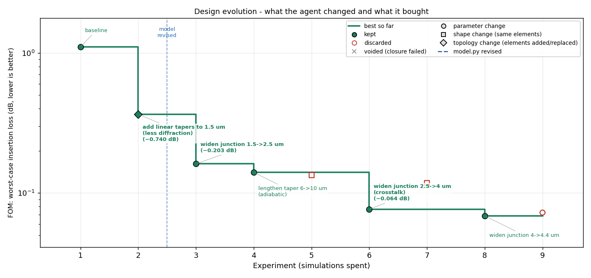
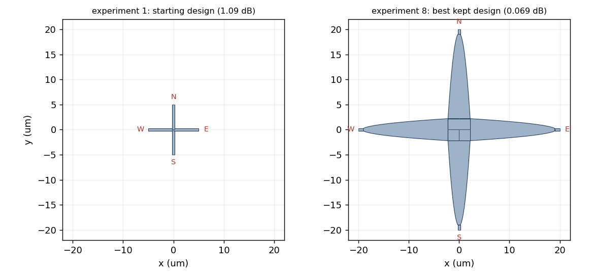
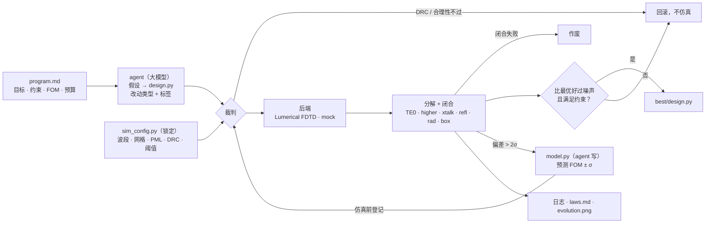

# photonics-design-agent（光子器件设计 Agent）

**一个在循环里调 Lumerical 仿真来设计光子器件的大模型 agent：每次仿真前必须先给出预测，仿真后要说清损耗去了哪里，并且记录每一步改的是什么（参数、形状还是拓扑；几何、掺杂还是电极），让优化历史读起来是一串设计决策，而不是一串随机尝试。**

[English](README.md) | [简体中文](README_zh-CN.md)


让大模型改几何文件、跑 FDTD、数字变好就保留，这个循环搭起来不难，也确实能找到好器件。它给不了的是理解：五十次仿真之后你手里有一个设计和一份"试了 X 得到 Y"的记录，但说不清哪一步起了作用，模型是真的懂了物理还是碰巧撞上，某一次仿真结果本身可不可信。对研究工具来说这笔交易不划算。这个仓库保留那个简单循环（方法名叫 **PRISM-Min**），加三样由代码而不是提示词来保证的东西：每次仿真返回**带实测通量闭合的损耗分解**；agent 必须**用自己写的物理模型先登记预测**，预测错了先修模型；每一轮都**标注改动的类型**，优化历史因此可以按设计决策来读。

<p align="center">
  <br>
  <br>
  <em>玩具后端上的离线演示：220 nm SOI 波导交叉在 8 次仿真内从 1.09 dB 降到 0.069 dB。标记形状 = 改动种类，标签 = agent 自己写的理由，加粗 = 超过 15% 的跳变，虚线 = agent 重写了物理模型。</em>
</p>

## 项目包含什么

代码分四部分，每部分可以单独替换。

**裁判**（`prism_min/evaluate.py`、`checks.py`、`decompose.py`、`guard.py`）是 agent 碰不到的部分。它从 `design.py` 构建几何，跑 DRC（最小线宽、间距、面积、端口位置）和仿真合理性检查（网格分辨率、端口直波导、四重对称），没有针对这个几何登记的预测就拒绝仿真，调用后端，把结果拆成直通端口基模、高阶模、串扰、反射、辐射五项，并且在包围器件的通量盒实测总通量不等于 1（容差内）时把这次运行作废。所有数值设置来自锁定的 `sim_config.py`，它的哈希写进每条记录。

**后端**（`prism_min/backends/`）把 `Geometry` 变成归一化的通量数据。`lumerical` 通过 lumapi 搭完整的 FDTD 工程：端口波导延伸穿过 PML、输入端模式源和反射监视器、其余端口的功率和模式展开监视器、六面通量盒、出场图的场监视器。`mock` 是交叉器件的解析模型，带 2% 确定性噪声，用来在没有 license 的机器上测试循环。

**agent 循环**（`prism_min/agent.py`、`prompts.py`、`llm.py`、`journal.py`）分设计轮和模型轮。设计轮里大模型读 `program.md`、当前 `design.py`、它自己的 `model.py`、`laws.md`、日志摘要和上一次的分解表，返回假设、修改、改动类型、一句话标签和完整的新 `design.py`。运行器让 `model.py` 给预测，仿真，只在约束满足且比最优值好过噪声阈值时保留。如果实测偏离预测超过 2σ，或者 `model.py` 已经不能把最近几次运行预测在 2σ 内（**理解门**），下一轮只能改 `model.py`。大模型用 `requests` 直接调用，Anthropic 和任何 OpenAI 兼容端点（DeepSeek、Qwen、中转）都可以。

**记录**（`journal.jsonl`、`journal.md`、`laws.md`、`evolution.png`）由运行器写，不是 agent 写。每一轮存下假设、声明的和自动分类的改动类型、标签、带 σ 的预测、实测、分解表和决定。`laws.md` 只追加，每条规律带着产生它的迭代号。`prism review` 开一个新的大模型会话，对照日志审计这些规律。

| 一次仿真返回什么 | 含义 |
|---|---|
| `through_TE0` | 直通端口基模功率，FOM 取它在波段内的最差损耗 |
| `through_higher` | 直通端口中非基模的功率（输出端模式失配） |
| `crosstalk` | 从侧端口泄漏的功率之和 |
| `reflection` | 输入端反向传播的功率 |
| `radiation` | 其余离开通量盒的功率 |
| `box_total` | 实测总出射通量，必须是 1 ± `closure_tol`，否则作废 |



## 快速开始

```bash
# 1. 安装（numpy、matplotlib、requests；Python >= 3.9）
git clone https://github.com/q3430468220-tech/photonics-design-agent.git
cd photonics-design-agent
pip install -e .

# 2. 不需要 API key 和仿真器，先看循环怎么转（脚本 agent + 玩具后端，约 10 秒）
python examples/demo_scripted.py          # 打印日志，生成 examples/demo_evolution.png

# 3. 配置大模型（和 Lumerical）
cp .env.example .env                      # ANTHROPIC_API_KEY 或 OPENAI_API_KEY + OPENAI_BASE_URL
#    PowerShell: $env:LUMERICAL_ROOT="D:\Program Files\ANSYS Inc\v251"   （包含 api\python\lumapi.py 的目录）

# 4. 从交叉模板建一个实验，写任务
prism init experiments/my_crossing
#    改 experiments/my_crossing/program.md      目标、约束、FOM、预算、提示
#    改 experiments/my_crossing/design.py       一个能通过检查的初始几何
#    改 experiments/my_crossing/sim_config.py   只在波段 / 网格 / 规则不同时

# 5. 花预算之前先验证裁判
prism check experiments/my_crossing --plot                       # 构建 + DRC + 合理性 + 模型预测，不仿真
prism eval  experiments/my_crossing --manual --backend lumerical # 你自己触发的一次仿真；看分解表和 box 那一列

# 6. 运行、查看、审计
prism run    experiments/my_crossing --backend lumerical --sims 50
prism status experiments/my_crossing
prism plot   experiments/my_crossing                             # evolution.png（每轮也会自动刷新）
prism review experiments/my_crossing                             # 独立的大模型会话审计 laws.md

# 测试
python -m unittest discover -s tests -t .
```

任何命令加 `--backend mock` 就在玩具模型上跑。Lumerical 打不开含中文的路径，实验文件夹放在纯英文路径下。

## 怎么写一个实验

`program.md` 就当是写给一个新来研究生的任务书：平台、端口接口、FOM 是什么、哪些约束是硬的、能花多少次仿真、你愿意给的提示。交叉的模板可以照着写。`design.py` 要定义 `build() -> Geometry`，`prism_min.geometry` 里的辅助函数（`rect`、`taper`、`profile_taper`、`four_fold`，以及给掺杂区和金属用的 `region`）够画大多数单层器件。`model.py` 要定义 `predict(geom) -> {"fom", "sigma", ...}`，模板里故意只放了一个粗糙的文献先验，agent 第一次预测失误后就应该换掉它。`sim_config.py` 是你的、锁定的：波段、网格、PML 边距、DRC 规则、FOM 阈值、噪声阈值、闭合容差、预算和理解门参数。

## 目录结构

```text
photonics-design-agent/
├── pyproject.toml                       pip 项目（Python >= 3.9；numpy、matplotlib、requests）
├── .env.example                         大模型提供方 / 模型名 / Lumerical 安装目录
├── prism_min/
│   ├── geometry.py                      几何表示：Polygon(layer, props) + Port；rect / taper / profile_taper /
│   │                                    four_fold / region；栅格化和形态学运算（numpy）；layer_domain()
│   ├── checks.py                        DRC（线宽、间距、面积、端口）和合理性检查（网格、端口直波导、对称）
│   ├── config.py                        SimConfig：所有锁定的数值及其哈希
│   ├── features.py                      几何测量（交叉口宽度、臂宽、taper 绝热参数 ……），
│   │                                    mock、提示词和 model.py 共用
│   ├── backends/
│   │   ├── base.py                      SimResult（各端口和通量盒的归一化通量）、Backend、注册表
│   │   ├── mock.py                      带噪声和闭合失败模式的解析交叉模型
│   │   └── lumerical.py                 通过 lumapi 搭 FDTD：结构、源、监视器、通量盒、场图
│   ├── decompose.py                     损耗分解、闭合检查、FOM 和约束
│   ├── guard.py                         PredictionRegistry：每个几何哈希对应一条登记的预测
│   ├── evaluate.py                      构建 → 检查 → 守卫 → 仿真 → 闭合 → 打分
│   ├── experiment.py                    实验文件夹、安全导入 design.py / model.py、快照、best/
│   ├── journal.py                       journal.jsonl + journal.md，给 agent 看的摘要
│   ├── llm.py                           Anthropic / OpenAI 兼容 / 脚本，用 requests
│   ├── prompts.py                       系统提示词、设计轮、模型轮、审计
│   ├── agent.py                         模式判断、校准、设计 / 模型轮、classify_change()
│   ├── viz.py                           几何预览、进化图
│   └── cli.py                           prism init | check | eval | run | status | plot | review
├── experiments/soi_crossing/            模板：program.md、sim_config.py、design.py、model.py、laws.md
├── examples/demo_scripted.py            离线演示（脚本大模型 + mock 后端）
├── docs/images/                         本文用到的图
├── tests/                               unittest：几何、检查、分解、守卫、解析、完整循环
└── ROADMAP.md  CONTRIBUTING.md  CITATION.cff  LICENSE
```

跑完一次之后的实验文件夹：

```text
experiments/my_crossing/
├── program.md  sim_config.py            你的
├── design.py  model.py  laws.md         agent 的
├── journal.jsonl  journal.md            每轮一条记录
├── evolution.png                        进化图
├── best/design.py                       当前最优设计
└── runs/iter_NNN/                       design.py + model.py 快照、llm_response.md、
                                         sim_result.json、eval.json、geometry.png、field_xy.png、sim.fsp
```

## 路线图

| 阶段 | 内容 | 状态 |
|---|---|---|
| 0 · 循环 | 裁判、守卫、分解 + 闭合、设计 / 模型轮、理解门、日志、进化图、mock 后端、测试 | **v0.1** |
| 1 · 真实仿真 | Lumerical FDTD 后端在交叉器件上验证；保留设计的细网格复核 | 已写，**未验证** |
| 2 · 证据 | 关掉分解 / 预测 / 理解门的同一循环作基线；同一参数化下的随机搜索和 CMA-ES；预测偏差分布作为"理解"指标 | 计划 |
| 3 · 无源器件库 | 几何辅助（圆弧、欧拉弯曲、贝塞尔、周期阵列）；弯曲、taper、MMI、定向耦合器模板 | 计划 |
| 4 · 有源器件 | CHARGE + FDE 后端；有源代数的分解（1/Q = 1/Q_c + 1/Q_int、Δn_eff/V = ΔN × 重叠、VπL 各因子、带宽限制）；MRM 和 TFLN MZM 模板 | 计划 |
| 5 · 搜索 | 在 agent 选定的结构内部做伴随法精调；多保真度初筛；结构不同的候选存档 | 计划 |

详见 [ROADMAP.md](ROADMAP.md)。

## 设计原则

agent 每轮只改一个文件，别的都不能动，能做什么由运行器强制。裁判锁定并带哈希，没有哪次运行能悄悄改网格或 FOM。只接受闭合的测量，坏的测量永远不会被当成坏的设计计分。没有预测就不仿真，预测错了付出的是一轮修模型，而不是一轮改设计。记录是机器可读的，"这些加的东西有没有用"这个问题要用日志回答，不用轶事。只有在日志显示出某种失败时，才加能修这种失败的模块。

## 状态与限制

这是 alpha 版。循环、裁判和记账有 27 个测试覆盖，在 mock 后端上端到端跑通。Lumerical 后端按 FDTD 2023–2025 的 lumapi 惯例写，但还没在真实安装上执行过，材料名和模式展开结果的键名大概率各需要改一行。改动分类器依据直通臂的宽度 profile、层名和多边形属性工作，它是对 agent 声明的交叉核对，不是真值。mock 后端是玩具，不要从它读物理。agent 写的 `design.py` 和 `model.py` 以你的权限执行，和所有 autoresearch 式循环一样。

## 免责声明

交叉模板里的设计规则取公开数值，仅用于教学和仿真设置。流片前请以具体 run 的设计手册和 PDK 为准。本项目与 Ansys、Anthropic 无关联亦未获其背书。"Ansys" 和 "Lumerical" 是 Ansys, Inc. 的商标。

## 贡献、引用、许可

欢迎贡献，尤其是一次验证过的 Lumerical 运行、新的器件模板和其他求解器的后端；见 [CONTRIBUTING.md](CONTRIBUTING.md)。如果这个项目对你的研究有帮助，请通过 [CITATION.cff](CITATION.cff) 引用。代码以 [MIT 许可](LICENSE) 发布。

相关项目：[photonics-layout-cookbook](https://github.com/q3430468220-tech/photonics-layout-cookbook)，gdsfactory 版图菜谱和 GDS → Lumerical 桥接；它的工艺文件和器件单元是这里有源器件阶段掺杂层和金属层的预期来源。
