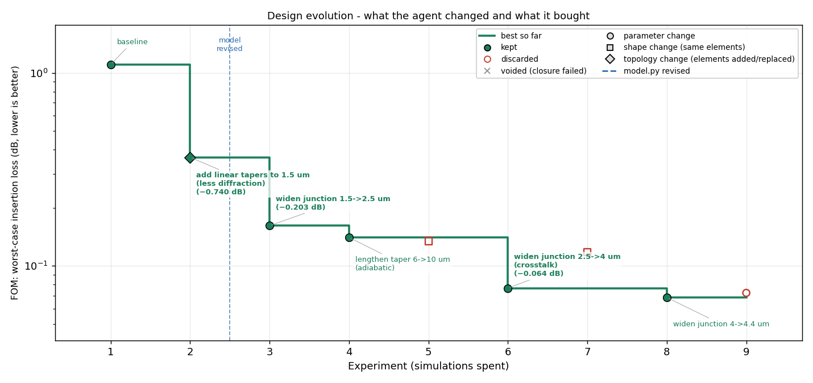

# photonics-design-agent

一个用大模型做无源光子器件设计的 agent：它在循环里改几何、跑仿真、保留更好的结果，
但**每次仿真前必须先给出预测**，预测错了就得先修自己的物理模型。

方法名 PRISM-Min。当前状态 v0.1：循环在玩具后端上验证通过，Lumerical 后端已写但未在真实软件上跑过。
英文版见 [README.md](README.md)。



## 要解决的问题

让大模型改几何文件、跑 FDTD、数字变好就保留，这件事现在已经能做了。但做完之后你什么都学不到：
50 次仿真之后手里有一个好设计和一堆"试了 X 得到 Y"的记录，说不清哪一步起了作用，agent 是真懂物理还是碰运气，
仿真本身可不可信。

这个项目保留那个循环，加三样东西：

1. **返回损耗分解，不只是一个数。** 每次仿真告诉你功率去了哪里：直通端口基模、高阶模、串扰、反射、辐射，
   外加一个实测的通量闭合检查。agent 知道该去打哪个通道。
2. **先预测再测量。** agent 自己维护一个 `model.py`，是它写的简化物理模型。每次仿真前必须用它预测结果和不确定度。
   测量偏离预测超过 2σ，下一轮只能改 `model.py`，不许改设计。
3. **记下做了什么、为什么。** 每轮声明改动类型（参数 / 形状 / 拓扑）和一句话标签，上面那张进化图就是从这些记录画出来的。

这些规则由运行器在代码里强制执行：agent 改不了仿真设置，跳不过预测，闭合失败的运行不计分。

## 它怎么工作

```
program.md（你写：目标、约束、预算）          sim_config.py（你写：锁定的 FDTD 设置）
      │                                                 │
      ▼                                                 ▼
 agent 改 design.py ──► DRC + 合理性检查 ──► model.py 预测 ──► 仿真
                            │ 不过：回滚，          （登记）          │
                            │ 不花仿真预算                             ▼
                                                          损耗分解 + 闭合检查
 日志 / laws.md / evolution.png ◄── 保留或回滚 ◄──── FOM + 约束
                                      │
                                      └── 偏差 > 2σ？下一轮只改 model.py
```

一轮迭代用一句话说：agent 读任务、当前设计、它的模型、它的笔记和上一次的分解结果，提出假设，重写 `design.py`；
运行器构建几何、做检查、让 `model.py` 给预测、仿真、分解损耗；只有在约束满足且比最优值好过噪声阈值时才保留。

## 安装

```bash
git clone https://github.com/q3430468220-tech/photonics-design-agent.git
cd photonics-design-agent
pip install -e .
cp .env.example .env     # 填 ANTHROPIC_API_KEY 或 OPENAI_API_KEY（DeepSeek/Qwen 另填 OPENAI_BASE_URL）
```

需要 Python ≥ 3.9、numpy、matplotlib、requests，不依赖厂商 SDK。
跑真实仿真需要 Lumerical FDTD，`LUMERICAL_ROOT` 指向安装目录（路径不能有中文）。

## 使用

**不需要 key 和仿真器，先看它怎么转**（脚本 agent + 解析玩具后端，约 10 秒）：

```bash
python examples/demo_scripted.py
```

**跑一个真实实验：**

```bash
prism init experiments/my_device         # 从 crossing 模板复制
#   改 experiments/my_device/program.md   目标、约束、FOM、预算
#   改 experiments/my_device/design.py    一个能通过检查的初始几何
#   波段 / 网格 / 规则不同的话改 sim_config.py

prism check experiments/my_device --plot            # 构建几何，跑 DRC 和合理性检查，不仿真
prism eval  experiments/my_device --manual --backend lumerical
#   你自己触发的一次仿真。看分解表和闭合误差。
#   裁判在这里就不对的话，后面全错。先把 sim_config.py 调对。

prism run   experiments/my_device --backend lumerical --sims 50
prism status experiments/my_device
prism plot   experiments/my_device                  # 生成 evolution.png（每轮也会自动刷新）
prism review experiments/my_device                  # 开一个新的 LLM 会话，对照日志审计 laws.md
```

任何命令加 `--backend mock` 就在玩具模型上跑。

## 实验文件夹里的文件

| 文件 | 谁改 | 是什么 |
|---|---|---|
| `program.md` | 你 | 任务描述，自然语言 |
| `sim_config.py` | 你 | 锁定设置：波段、网格、PML、DRC 规则、FOM 阈值、预算 |
| `design.py` | agent | `build() -> Geometry` |
| `model.py` | agent | `predict(geom) -> {fom, sigma, ...}`，它的物理模型 |
| `laws.md` | agent | 经验规律，只追加，标 tentative / confirmed |
| `journal.jsonl` / `.md` | 运行器 | 每轮：假设、修改、类型、预测、实测、分解、决定 |
| `evolution.png` | 运行器 | 上面那张图 |
| `runs/iter_NNN/` | 运行器 | 快照、LLM 原始回复、仿真数据、图 |
| `best/design.py` | 运行器 | 当前最优设计 |

## 一次仿真返回什么

```
wl(um)  IL(dB)  TE0     higher  xtalk   refl    rad     box
1.5300   1.069  0.7818  0.0001  0.0925  0.0002  0.1239  0.9986
```

都是注入功率的比例。`TE0` 是有用的透射，FOM 取波段内最差的插损。`box` 是包围器件的通量盒实测的总出射功率，
必须是 1 ± `closure_tol`，否则这次运行作废（测量坏了不等于设计坏了）。

## 后端

- `mock`：交叉器件的解析玩具模型。用来测循环，不是物理。
- `lumerical`：通过 lumapi 调 FDTD。根据 `sim_config.py` 搭源、监视器、6 面通量盒和场图。
  **还没在真实安装上跑过**，先用 `prism eval --manual --backend lumerical` 验证。最可能要改的是材料名和模式展开结果的键名。

## 现在的模板

`experiments/soi_crossing`：220 nm SOI 波导交叉，目标 1530–1570 nm 最差插损 < 0.06 dB，串扰 < −30 dB，四重对称，40 µm 以内。

## 还没做的

- 在真实 Lumerical 上验证后端。
- 基线对比（去掉分解 / 预测 / 理解门的同一循环、随机搜索、CMA-ES），看这些加的东西到底有没有用。日志是机器可读的，为这个留了接口。
- 更多几何辅助函数（圆弧、贝塞尔、周期阵列），让 agent 少在写多边形上出错。
- 有源器件（微环调制器、TFLN 调制器）：思路相同，分解的代数形式不同。

## 目录

```
prism_min/
  geometry.py    多边形 + 端口，栅格工具
  checks.py      DRC 和合理性检查
  config.py      SimConfig
  features.py    几何特征（mock、提示词、model.py 共用）
  backends/      base、mock、lumerical
  decompose.py   损耗分解、闭合、FOM
  guard.py       没有登记预测就不仿真
  evaluate.py    构建 → 检查 → 守卫 → 仿真 → 闭合 → 打分
  experiment.py  实验文件夹管理
  journal.py     日志和给 agent 看的摘要
  llm.py         Anthropic / OpenAI 兼容 / 脚本
  prompts.py     提示词
  agent.py       循环本身
  viz.py         几何预览、进化图
  cli.py         prism 命令
experiments/soi_crossing/   模板
examples/demo_scripted.py   离线演示
tests/                      python -m unittest discover -s tests -t .
```

MIT 许可。
